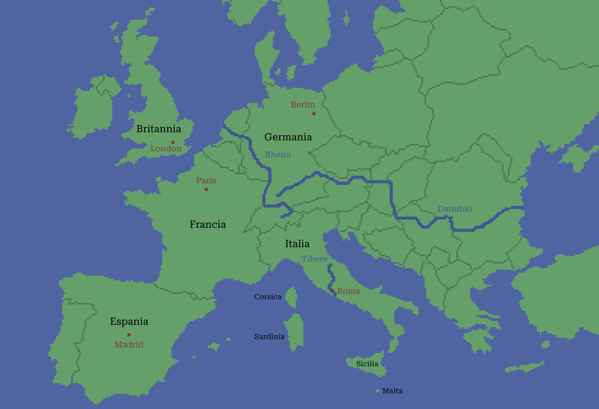

# Capitulo Prime: Europa Occidental

Roma es in Italia. Italia es in Europa. Francia es in Europa. Italia e Francia es in Europa. Espania es etiam in Europa. Espania e Francia e Italia es in Europa.

Britannia e Germania es etiam in Europa. In Europa, es Italia, Francia, Espania, Britannia e Germania. In Italia, es Roma. In Francia, es Paris. In Espania, es Madrid. In Britania, es London. E in Germania, es Berlin.

Es Roma in Italia? Roma es in Italia. Es Madrid in Italia? Madrid non es in Italia, Madrid es in Espania. Es Paris in Espania? Paris non es in Espania, sed in Francia.

> - es <-> non es

Ubi es London? London es in Britannia. Ubi es Britannia? Britannia es in Europa. Es Berlin in Britannia? Berlin non es in Britannia, sed in Germania. Ubi es Germania? Germania es in Europa.

Que es Danubio? Danubio es un fluvio. Que es Rheno e Tibere? Rheno e Tibere es etiam fluvios. Tibere es ubi? Tibere es un fluvio in Italia. Ubi es Rheno e Danubio? Rheno e Danubio es fluvios in Europa.

> - un = 1
> - -s
>   - Danubio es un fluvio.
>   - Rheno e Tibere es fluvio*s*.

Danubio es grande. Rheno es etiam grande. Tibere non es grande, sed parve. Danubio e Rheno es fluvios grande. Tibere es un fluvio parve.

> - grande <-> parve

Que es Corsica, Sardinia e Sicilia? Illos es insulas. Corsica, Sardinia e Sicilia es grande insulas. Britannia es etiam un grande insula. Malta es un insula. Malta non es grande, sed parve. Illo es un parve insula.

> - illos : Corsica e Sardinia e Sicilia
> - illo : Malta
> - insula grande = grande insula
> - insula parve = parve insula

Que es Italia, Francia, Espania, Britannia e Germania? Illos es paises. Que es Roma, Paris, Madrid, London e Berlin? Illos es urbes.

> - illos (1) : Italia, Francia, Espania, Britannia e Germania
> - illos (2) : Roma, Paris, Madrid, London e Berlin
> - -es = -s
>   - a, e, i, o, u : -s
>       - urbe -> urbe*s*
>   - b, c, d, f, g... : -es
>       - pais -> pais*es*

Roma es ubi? Illo es un urbe in Italia. Italia es ubi? Illo es un pais in Europa.

> - illo (1) : Roma
> - illo (2) : Italia