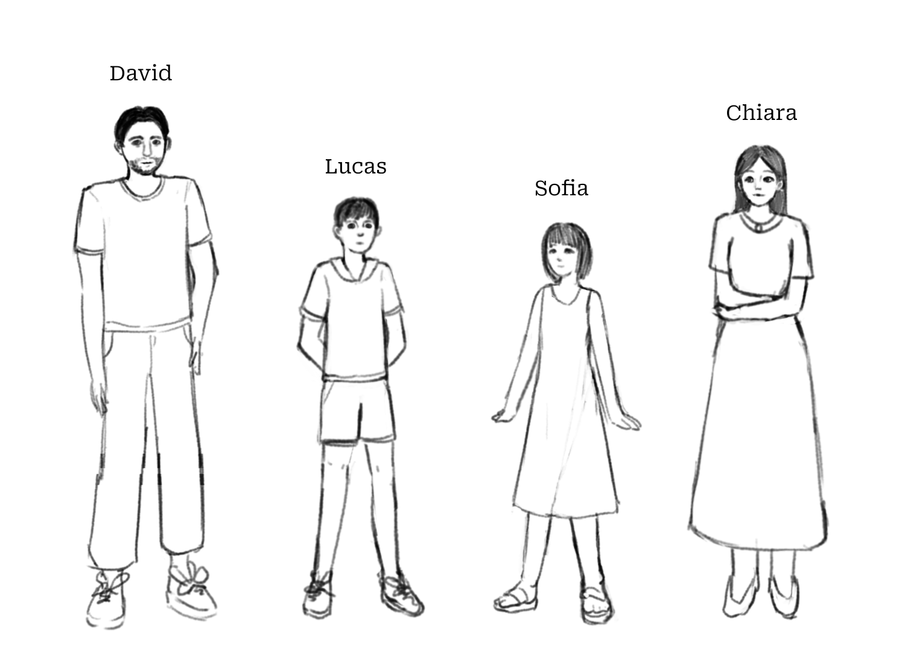

# Capitulo Secunde: Familia Europee

David es un homine. Chiara es un femina. Lucas es un puero. Sofia es un puera. David e Chiara es adultos. Lucas e Sofia non es adultos, sed infantes. Adultos es grande. Infantes es parve.

> - adulto : {homine, femina}
> - infante : {puero, puera}

Es Lucas un homine? Lucas non es un homine, sed un puero. Es Sofia un femina? Sofia non es un femina, sed un puera.

David, Chiara, Lucas e Sofia es un familia in Europa. David es le patre. Chiara es le matre. David es le patre de Lucas e Sofia. Chiara es le matre de Lucas e Sofia. Lucas es le filio de David e Chiara. Sofia es le filia de David e Chiara. Lucas e Sofia es le infantes de David e Chiara. David e Chiara es le parentes de Lucas e Sofia.

> - parente : {patre, matre}
> - infante : {filio, filia}

Qui es Lucas? Lucas es un puero. Qui es le patre de Lucas? Le patre de Lucas es David. Qui es le matre de Lucas? Le matre de Lucas es Chiara. Qui es Sofia? Sofia es un puera. Qui es le patre e le matre de Sofia? Le patre e le matre de Sofia es David e Chiara. Qui es le filio e le filia de David e Chiara? Le filio e le filia de David e Chiara es Lucas e Sofia.

Lucas es le filio de qui? Lucas es le filio de David e de Chiara. Sofia es le filia de qui? Sofia es le filia de David e de Chiara. Lucas e Sofia es le infantes de qui? Lucas e Sofia es le infantes de David e Chiara.

David es un homine alte. Es Lucas alte? Lucas es un puero alte. Es Lucas plus alte que David? Lucas non es plus alte que David, sed minus alte que David.

> - alte $\approx$ grande
> - "A es plus ... que B" : A > B
> - "A es minus ... que B" : A < B

Es Sofia un puera alte? Sofia es alte, sed non plus alte que Lucas. Sofia es plus breve que Lucas, Chiara e David. Sofia es le plus breve, etiam le minus alte in le familia. Parve Sofia!

> - breve $\approx$ parve
> - "A es le plus ..." : A > B, C, D...
> - "A es le minus ..." : A < B, C, D...
> - plus breve = minus alte